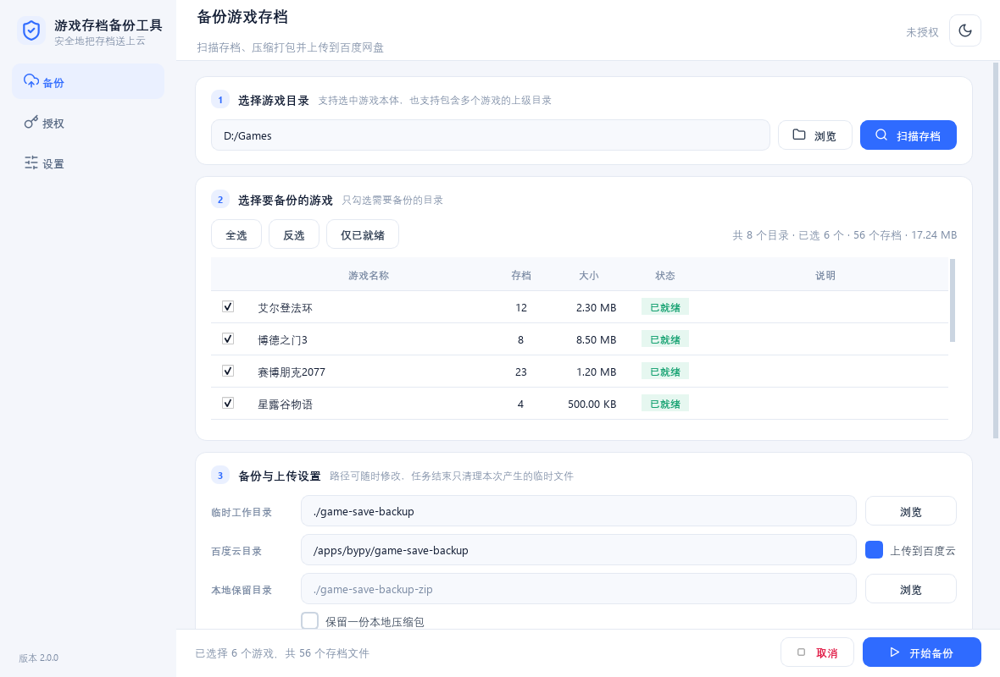

# 游戏存档备份工具 2.0.0

扫描指定目录下的游戏存档，复制、压缩并上传到百度网盘。界面基于 **PySide6**，
提供真实进度、随时取消、深浅色主题与后台线程执行，不会卡死窗口。



## 下载

从 [Releases](https://github.com/kongyuliuyun/game_save_file_handle/releases/latest)
下载最新版单文件 `GameSaveBackup.exe`，双击即可运行，无需安装 Python。

## 功能特性

- **智能扫描**：既可以选中单个游戏本体目录，也可以选中包含多个游戏的上级目录；
  按扩展名识别存档，支持白名单过滤。
- **真实进度**：扫描按目录数、复制按字节、压缩按原始字节、上传按已发送字节
  上报进度；总量未知时显示不确定态，绝不编造百分比。
- **随时取消**：复制、打包、上传的每个数据块边界都会检查取消信号；
  清理阶段不可取消，保证临时文件一定被删除。
- **安全清理**：每次任务在 `<工作目录>/run-时间戳-随机/` 独立子目录中进行，
  结束时只删除这个子目录，**不会碰用户配置的父目录**。
- **百度网盘直连**：小于 2GB 走 PCS 流式上传，大于 2GB 走 XPAN 分片上传；
  令牌过期自动刷新，网络错误指数退避重试。
- **并发上传**：多个压缩包可同时上传（默认 3 个线程），每个线程使用独立的
  HTTP 会话，进度按所有文件已发送字节汇总，仍然真实且单调。
- **现代化界面**：侧边导航、卡片式布局、自绘圆角进度条、顶部浮层提示，
  支持浅色 / 深色主题；图标颜色随主题自动重新渲染。

## 环境要求

- Windows 10 / 11
- Python 3.10+（仅源码运行时需要）

## 安装

```bash
pip install -r requirements.txt
```

依赖：`PyYAML`、`requests`、`PySide6`。

## 运行

```bash
# 方式一：在项目根目录直接运行
python run_gui.py

# 方式二：作为包运行（在项目父目录）
python -m game_save_file_handle.run_gui
```

## 使用说明

### 备份存档

1. 在「备份」页选择游戏目录（可选中游戏本体，也可选中包含多个游戏的上级目录）；
2. 点击「扫描存档」，等待扫描完成；
3. 勾选要备份的游戏（支持全选 / 反选 / 仅已就绪）；
4. 设置临时工作目录、百度云目录，决定是否上传、是否保留一份本地压缩包；
5. 点击「开始备份」。

扫描、复制、压缩、上传各阶段的进度、速度、剩余时间都来自真实采样。
随时可以点击「取消」，任务结束后临时目录会被自动清理。

### 百度云授权

首次上传前需要完成一次 OAuth 授权：

1. 切换到「授权」页，点击「打开授权页面」；
2. 在浏览器中登录百度账号并同意授权，页面会显示一串授权码；
3. 把授权码粘贴到输入框，点击「完成授权」。

令牌保存在 `%USERPROFILE%\.bypy\bypy.json`，与 [bypy](https://github.com/houtianze/bypy)
工具通用，有效期约 30 天，过期后程序会自动刷新，无需重复登录。

### 设置

「设置」页可以修改：

- 存档文件扩展名（逗号或换行分隔）；
- 扫描白名单（可直接编辑文本，也可点「添加目录」从文件夹选择）；
- 默认临时工作目录、百度云目标目录、本地保留目录；
- 并发上传线程数（1–8）；
- 是否上传前校验压缩包、是否默认上传；
- 浅色 / 深色主题。

修改后点击「保存设置」写入配置文件。

## 配置文件

配置文件按以下顺序查找：

1. 可执行文件（或项目根目录）旁的 `config.yaml` —— 推荐用户自行放置；
2. 用户配置目录 `%APPDATA%\GameSaveBackup\config.yaml`（exe 目录不可写时自动使用）；
3. 内置的 `config/config.yaml`（打包产物内的只读默认值）。

保存设置时优先写入第 1 项；若 exe 所在目录不可写（例如安装在
`Program Files`），会自动回退到第 2 项。程序绝不会把配置写入打包器退出即
销毁的临时目录，因此修改主题、扩展名等设置后重启仍然生效。

```yaml
# 存档文件扩展名
save_extensions:
  - .sav
  - .save
  - .esm
  - .esp
  - .bsa
  - .ba2
  - .rpgsave
  - .rmmzsave
  - .phxsav

# 扫描白名单：根目录 -> 允许的游戏名列表，"all" 表示全部放行
white_list_root_path:
  default:
    - all

# 临时工作目录（相对路径 = 程序所在目录）
save_backup_path: ./game-save-backup

# 保留本地压缩包的目录
zip_backup_path: ./game-save-backup-zip

# 百度云目标目录
remote_dir: /apps/bypy/game-save-backup

# 是否保留一份本地压缩包
keep_local_backup: false

# 是否默认上传到百度云
upload_enabled: true

# 主题：light / dark
theme: light

# 并发上传线程数（1 = 串行）
upload_threads: 3

# 上传前校验压缩包完整性
verify_upload: true
```

相对路径基于程序所在目录解析；配置的盘符不存在时会自动回退并提示。
工作目录不可写时，任务会自动改用系统临时目录。

## 项目结构

```
game_save_file_handle/
├── run_gui.py                  # 入口，注入 sys.path 后启动 GUI
├── app/
│   ├── bootstrap.py            # QApplication、高 DPI、字体、主题
│   └── theme.py                # 浅色/深色调色板与 QSS
├── core/                       # 业务逻辑（不依赖 UI / 网络）
│   ├── errors.py               # 统一异常体系
│   ├── models.py               # GameEntry / SaveFile / TaskReport
│   ├── config.py               # AppConfig、YAML 读写、旧配置兼容
│   ├── progress.py             # Stage / ProgressEvent / 取消令牌 / 速度计
│   ├── scanner.py              # 单遍 scandir 扫描 + 白名单
│   ├── backup.py               # 按字节进度复制存档
│   ├── packager.py             # 按原始字节进度打包 ZIP
│   └── pipeline.py             # scan → copy → pack → upload → cleanup 编排
├── cloud/
│   ├── auth.py                 # OAuth、令牌自动刷新、bypy 兼容存储
│   └── baidu_pan.py            # PCS 流式上传 / XPAN 分片上传
├── ui/
│   ├── main_window.py          # 侧边栏 + 顶栏 + 三页堆栈 + Toast
│   ├── widgets/                # Card / StatusBadge / ProgressBar / Nav / Toast
│   │                           # 以及 themed.py（图标跟随主题换色）
│   └── pages/                  # backup / auth / settings
├── utils/                      # paths.py、fmt.py
├── tests/                      # test_core.py、test_upload.py
├── scripts/
│   ├── build_exe.bat           # 一键打包
│   ├── render_preview.py       # 离屏渲染界面预览图
│   ├── smoke_ui.py             # 界面运行期冒烟测试
│   └── live_check.py           # 真实百度账号联调自检
├── config/config.yaml          # 默认配置
├── GameSaveBackup.spec         # PyInstaller 打包配置
└── img/icon.ico                # 图标
```

## 测试

```bash
# 核心逻辑与配置持久化（25 项）
python tests/test_core.py

# 上传逻辑（6 项，使用本地模拟 HTTP 服务器校验字节）
python tests/test_upload.py

# 界面运行期冒烟测试（49 项，离屏，不弹窗）
python scripts/smoke_ui.py
```

> 本机 `python -m pytest` 会卡死（pytest 7.1.2 终端初始化问题），
> 请直接用上面的脚本方式运行 `unittest`。

## 真实账号联调

本地模拟服务器只能验证请求格式与字节一致性。真实上传前，建议用已授权的账号
跑一次自检：

```bash
# 只读检查：令牌、账号信息、网盘配额
python scripts/live_check.py

# 额外验证 PCS 单次上传（1MB，完成后自动删除测试文件）
python scripts/live_check.py --upload

# 用 1MB 文件强制走 XPAN 分片接口，验证 precreate/superfile2/create 链路
python scripts/live_check.py --chunked
```

测试文件统一放在 `/apps/bypy/game-save-backup/live-check/`，并在结束时删除。

## 打包为 EXE

```bash
scripts\build_exe.bat
```

脚本会：

1. 创建独立虚拟环境 `.venv_build`，避免系统 Python 的冲突包影响打包；
2. 安装 `requirements.txt` 与 PyInstaller；
3. 读取 `GameSaveBackup.spec` 打包为单文件 `dist\GameSaveBackup.exe`。

> 将 `config.yaml` 放在 exe 同目录即可自定义配置；
> 未放置时使用内嵌的默认配置。

打包后可用诊断模式验证网络与 SSL：

```bash
dist\GameSaveBackup.exe --self-check
```

结果写入 `%TEMP%\GameSaveBackup-selfcheck.json`，包含 OpenSSL 版本与访问
百度 HTTPS 的状态码。

## 更换图标

1. 准备 `img/icon.png`（建议 256×256）；
2. 转换为 ICO：
   ```bash
   pip install Pillow
   python -c "from PIL import Image; img=Image.open('img/icon.png'); img.save('img/icon.ico', format='ICO', sizes=[(16,16),(32,32),(48,48),(64,64),(128,128),(256,256)], bitmap_format='bmp')"
   ```
3. 重新运行 `scripts\build_exe.bat`。

## 常见问题

**Q: 扫描不到存档？**
检查设置页的扩展名是否包含目标文件的后缀（例如 `.sav`）。不确定时可以先用
默认扩展名扫描一次，日志会列出命中的文件。

**Q: 上传提示未授权？**
到「授权」页完成一次授权。令牌过期后程序会尝试自动刷新；刷新失败时需要重新授权。

**Q: 任务取消后文件还在吗？**
不会。取消后会执行清理，只删除本次任务创建的 `run-*` 子目录。

**Q: 备份路径所在磁盘不存在？**
程序会检测盘符并回退到可用磁盘，同时在界面提示。

**Q: 界面在缩小窗口后内容被挤压？**
页面内容区是可滚动区域，底部操作栏固定；缩小窗口时请使用滚动条查看全部内容。

**Q: 打包版上传提示「SSL module is not available」？**
PyInstaller 可能从 PATH 误收集了其他软件（例如 Git）的 OpenSSL DLL，
与项目使用的 Python 版本不匹配。`GameSaveBackup.spec` 已显式收集正确的
OpenSSL DLL，重新运行 `scripts\build_exe.bat` 打包即可；也可以先执行
`dist\GameSaveBackup.exe --self-check` 确认 SSL 状态。
